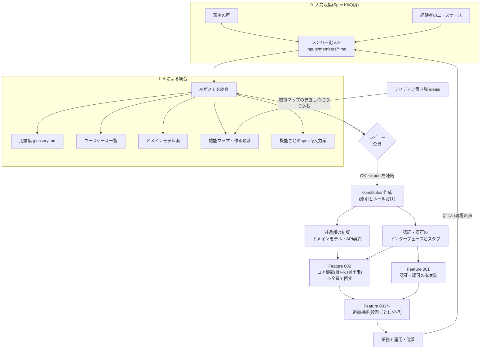
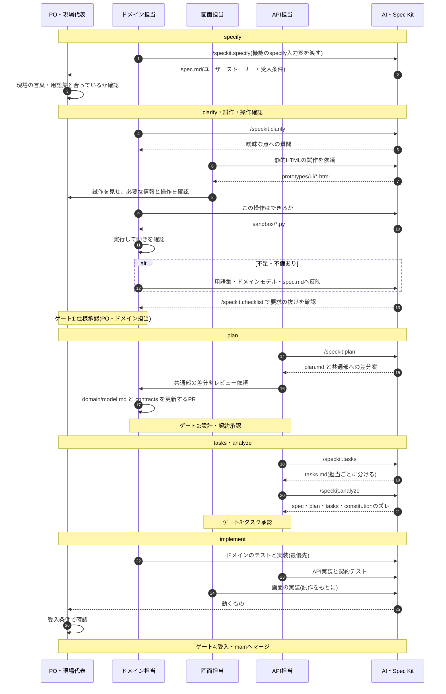
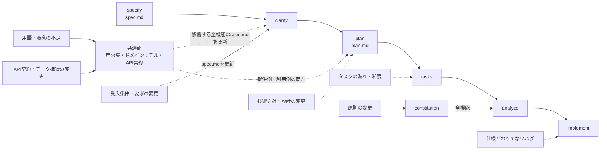
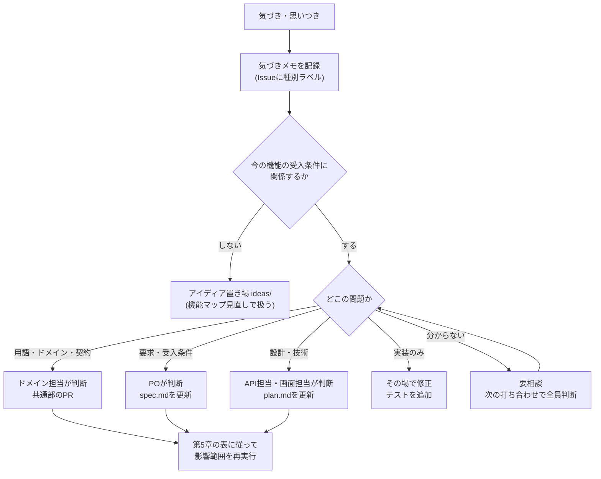

# Spec Kitによる小規模チーム開発 進め方ガイド

## 0. このガイドについて

### 目的

- AIとSpec Kitを初めて使うチームが、小さなアプリを作りながら使い方を身につける
- 作るアプリは使い捨てにせず、業務で使いながら改善を続けられる品質で作る

### 前提

- 要求のもとになるのは、現場の声と、経験者が考えるユースケースです
- 機能は一度に全部作りません。コア機能(例:機材管理なら、機材の最小限の扱い)から始め、1つのリポジトリ・1つのSpec Kitの中で整合を取りながら機能を足していきます
- 共通部(用語集・ドメインモデル・API契約)は1か所で管理します
- 共通機能(認証・認可)は別の機能として作り、アプリはそれに依存する形で作ります

### 基本ルール(迷ったらここに戻る)

1. **上流を先に直す**:コードより先にspec、specより先に共通部を直す
2. **上流を直したら、そこから下流をすべて通し直す**(第5章の表を参照)
3. **共通部は1か所だけ**:各機能のspecやplanは共通部を参照し、コピーしない
4. **気づいたら、まず記録する**:その場で直す前に、気づきメモ(Issue)を残す(第6章)
5. **新しいアイディアは今の機能に入れない**:アイディア置き場に入れ、次以降の機能で扱う
6. **AIの出力は必ず人が承認する**:承認ゲートを省かない

---

## 1. 役割

小規模チームを想定しているため、1人が複数の役割を兼ねてかまいません。

| 役割 | 責任 | 主に見るもの |
|---|---|---|
| PO・現場代表 | 要求と受入条件の最終判断。アイディアの優先順位付け | spec.md、HTML試作、動くもの |
| ドメイン担当(経験者) | 共通部(用語集・ドメインモデル・API契約)のオーナー | 用語集、ドメインモデル、sandbox |
| API担当 | API・永続化の設計と実装 | plan.md、contracts、tasks.md |
| 画面担当 | 画面の試作と実装(Modern Web Guidanceに従う) | HTML試作、spec.md、contracts |
| AI(Spec Kit) | 統合・下書き・生成・整合性チェック | すべての成果物 |

---

## 2. リポジトリ構成

```
repo/
  inputs/                  # 入力(統合後に凍結)
    voices/                # 現場の声
    members/<名前>.md      # メンバー別メモ(断片でよい)
  ideas/                   # アイディア置き場(第6章)
  docs/
    glossary.md            # 用語集(唯一)
    usecases.md            # 統合したユースケース一覧
    feature-map.md         # 機能一覧・依存関係・作る順番
    domain/model.md        # ドメインモデル(唯一)
  contracts/openapi.yaml   # 共通のAPI契約(唯一)
  prototypes/ui/           # 静的HTMLの試作
  sandbox/                 # 「この操作はできるか」確認用スクリプト(本番コードではない)
  .specify/memory/constitution.md
  specs/
    001-auth/              # 認証・認可
    002-equipment-core/    # コア機能
    003-.../
  src/{domain,api,web}/
  tests/
```

---

## 3. 全体の流れ



### 3.1 フェーズ0:入力収集(Spec Kitの前)

| 誰が | 見るもの | やること |
|---|---|---|
| 全員 | 現場の声、自分の経験 | `inputs/members/<名前>.md` に、ユースケース・画面に必要な要素・困りごとなどを断片でよいので書く |
| PO・現場代表 | 現場の声 | `inputs/voices/` に原文に近い形で残す(要約しすぎない) |

**メモの書き方のコツ**
- 1項目1行で書き、先頭にIDを付ける(例:`[山田-03] 貸出中の機材を一覧で見たい`)
- 「誰が・何を・なぜ」が分かれば十分。用語のブレは気にしなくてよい(次のフェーズで直す)

### 3.2 フェーズ1:AIによる統合とレビュー

| 誰が | 見るもの | やること |
|---|---|---|
| AI | 全員のメモ | 用語集・ユースケース一覧・ドメインモデル案・機能マップ・機能ごとのspecify入力案を作る。元メモのIDを出典として残す |
| 全員 | AIの統合結果 | 用語のブレ(同じものを別の言葉で呼んでいないか)と、自分のメモが落ちていないかを確認する |
| PO・現場代表 | 機能マップ | 作る順番(コア機能 → 追加機能)を決める |
| ドメイン担当 | 用語集・ドメインモデル案 | 共通部の初版として確定させる |

レビューが通ったら、`inputs/` を凍結します。以後の変更は用語集・spec側で行います。

### 3.3 constitutionの作成

constitutionには、変わりにくい原則とルールだけを書きます。用語集や機能分割そのものは書きません(頻繁に変わるため)。

**書く内容の例**
- 用語は `docs/glossary.md` に従う
- ドメインモデルとAPI契約は `docs/domain/` と `contracts/` が唯一の正とし、各機能はそれを参照する
- コードより先にspecを、specより先に共通部を変更する
- ドメイン層はテストを先に書く
- 画面はModern Web Guidanceに従う
- DBの変更はマイグレーションで行う

### 3.4 認証・認可を先に「窓口だけ」決める

- 「現在のユーザーを取得する」「権限をチェックする」というインターフェースを最初に決める
- アプリ側はスタブ(仮実装)を使って開発を進める
- 認証・認可の本実装は Feature 001 として並行して作る

### 3.5 機能の切り方

- 機能はレイヤ(画面・API)ではなく、ユースケース単位の縦切りにする(例:「機材を登録できる」)
- 役割ごとの分担は、tasksの段階で分ける
- 1機能 = 1ブランチ = 1PR(spec・plan・tasks・コードを含める)。小さく保つ
- **最初の1機能(コア機能)は全員同席で回す**。分担するのは2機能目から

---

## 4. 1機能のサイクル



### 4.1 specify

| 誰が | 見るもの | やること |
|---|---|---|
| ドメイン担当 | 機能ごとのspecify入力案 | `/speckit.specify` を実行する |
| PO・現場代表 | spec.md | 受入条件が現場の言葉で書かれているか、用語集と合っているかを確認する |
| 全員 | spec.md | 技術的な内容(DB・フレームワーク)が混ざっていないか確認する(それはplanで扱う) |

### 4.2 clarify・試作・操作確認

| 誰が | 見るもの | やること |
|---|---|---|
| ドメイン担当 | AIからの質問 | `/speckit.clarify` を実行して答える。答えられない質問はPOに回す |
| 画面担当 | spec.md | AIに静的HTMLの試作を作らせ、POに見せる。決めるのは「画面に必要な情報と操作」で、見た目の細部は後回し |
| ドメイン担当 | ドメインモデル | 「この操作はできるか」とAIに尋ね、`sandbox/` のPythonスクリプトを実行して動きを確かめる |
| 全員 | 試作・sandboxの結果 | 不足に気づいたら気づきメモを書く(第6章) |
| AI | spec.md | `/speckit.checklist` で要求の抜けを確認する |

**ゲート1:仕様承認**(PO・ドメイン担当)

### 4.3 plan

| 誰が | 見るもの | やること |
|---|---|---|
| API担当 | spec.md、共通部 | `/speckit.plan` を実行する。共通部は直接書き換えず、差分案として出させる |
| ドメイン担当 | 共通部への差分案 | 共通部(`docs/domain/`、`contracts/`)を更新するPRを出す |
| 画面担当 | contracts の差分 | 画面に必要な情報が契約に含まれているか確認する |

**ゲート2:設計・契約承認**(ドメイン担当・API担当・画面担当)

### 4.4 tasks・analyze

| 誰が | 見るもの | やること |
|---|---|---|
| API担当 | plan.md | `/speckit.tasks` を実行し、タスクに担当(ドメイン・API・画面)を割り振る |
| 全員 | `/speckit.analyze` の結果 | spec・plan・tasks・constitutionのズレを解消する |

**ゲート3:タスク承認**(各担当)

### 4.5 implement

| 誰が | 見るもの | やること |
|---|---|---|
| ドメイン担当 | tasks.md、sandbox | ドメインのテストと実装を最優先で行う。sandboxで確認した操作はテストに昇格させる |
| API担当 | tasks.md、contracts | APIを実装し、契約テストを通す |
| 画面担当 | tasks.md、HTML試作 | 試作をもとに画面を実装する |
| PO・現場代表 | 動くもの | 受入条件で確認する |

**ゲート4:受入・mainへマージ**(PO)

---

## 5. 変更が入ったときのやり直し範囲



| 見つかった変化 | 直す場所 | Spec Kitで再実行する範囲 |
|---|---|---|
| 用語・概念の不足 | 用語集・ドメインモデル → 影響する機能のspec.md | clarify → plan → tasks → analyze |
| 受入条件・要求の変更 | spec.md | clarify → plan → tasks → analyze |
| API契約・データ構造の変更 | contracts・ドメインモデル | 提供側と利用側の両方で plan → tasks → analyze |
| 技術方針・設計の変更 | plan.md | tasks → analyze |
| タスクの漏れ・粒度 | tasks.md | analyze → implement |
| 仕様どおりでないバグ | コードのみ | implement(再発防止のテストを追加) |
| 原則の変更 | constitution | 全機能でanalyze |

**注意**:既存機能のspecを直すときは、`/speckit.specify` をもう一度実行しません(specifyは新しい機能を作るコマンドのため)。spec.mdを直接(またはAIに依頼して)更新し、clarifyから再実行します。

---

## 6. イレギュラー(気づき・思いつき)が起きたとき

### 6.1 共通の動き

どの段階でも、気づいたら次の順で動きます。

1. **手を止めて記録する**:その場で直す前に、気づきメモ(Issue)を書く
2. **種別を付ける**:下の表から選ぶ。迷ったら「要相談」
3. **判断者に回す**:種別ごとの判断者が、今の機能で扱うか後回しにするかを決める
4. **今扱うなら、上流から直す**:第5章の表に従って再実行する
5. **後回しなら、置き場に入れる**:アイディア置き場や次の機能の入力にする



### 6.2 気づきの種別と判断者

| 種別 | 例 | 判断者 | 直す場所 |
|---|---|---|---|
| 用語 | 同じものを別の言葉で呼んでいた | ドメイン担当 | glossary.md |
| ドメイン | 試作で必要な項目がモデルにない。sandboxで想定した操作ができない | ドメイン担当 | domain/model.md |
| 契約 | 画面に必要な情報がAPIで取れない | ドメイン担当(提供側・利用側の承認も必要) | contracts/ |
| 要求 | 受入条件が現場の運用と合わない。例外ケースが抜けていた | PO | spec.md |
| 設計 | 性能やライブラリの都合で設計を変えたい | API担当・画面担当 | plan.md |
| タスク | タスクが大きすぎる。抜けがある | 各担当 | tasks.md |
| バグ | 仕様どおりに動かない | 実装担当 | コード・テスト |
| アイディア | 「こんな機能もあるといい」 | PO | ideas/ |
| 原則 | ルール自体がチームに合わない | 全員 | constitution.md |

### 6.3 気づきメモのテンプレート

```markdown
## 気づきメモ
- 種別: 用語 / ドメイン / 契約 / 要求 / 設計 / タスク / バグ / アイディア / 原則 / 要相談
- 見つけた段階: specify / clarify / 試作 / sandbox / plan / tasks / analyze / implement / 運用
- 対象の機能: 002-equipment-core など
- 内容: 何に気づいたか(1〜3行)
- きっかけ: どの画面・操作・質問で気づいたか(試作やsandboxのファイル名)
- 影響しそうな範囲: 分かる範囲で(他の機能・共通部)
- 提案: あれば
```

### 6.4 場面別の動き

#### (1) 試作(静的HTML)で、画面に必要な情報が足りないと気づいた

1. 画面担当が気づきメモ(種別:ドメインまたは契約)を書く
2. ドメイン担当が、用語集・ドメインモデルに追加するか判断する
3. 追加するなら共通部のPRを出し、影響する機能のspec.mdを更新して、clarifyからやり直す
4. 試作を更新してPOに再確認してもらう

#### (2) sandboxで「この操作ができない」「想定と違う動き」だった

1. ドメイン担当が気づきメモ(種別:ドメイン)を書き、sandboxのファイル名を添える
2. モデルの不足なら共通部を直す。要求の誤解ならPOに確認してspec.mdを直す
3. 直したあと、同じsandboxを再実行して確認し、その操作をテストに昇格させる

#### (3) plan・implementの途中で、API契約を変えたくなった

1. 気づいた人が気づきメモ(種別:契約)を書く
2. **影響するタスクだけを保留にする**(tasks.mdに「保留:#Issue番号」と書く)。影響しないタスクは続ける
3. ドメイン担当が契約のPRを出し、提供側・利用側の両方の担当が承認する
4. 両側の機能で plan → tasks → analyze を再実行し、保留を解除する
5. 後方互換のない変更なら、利用側が追従するまで旧版を残すかを判断する

#### (4) 作業中に「こんな機能もあるといい」と思いついた

1. 思いついた人が `ideas/` に書く(気づきメモの種別:アイディア)
2. **今の機能には入れない**。今の機能が終わってから、POが機能マップを見直すときに優先順位を付ける
3. 今の機能の受入条件を満たすのに必要だと分かった場合だけ、種別を「要求」に変えてPOが判断する

#### (5) 受入確認で、POが「思っていたのと違う」と感じた

1. POが気づきメモを書き、受入条件どおりかどうかを先に確認する
   - 受入条件どおりに動いている → 受入条件の書き方の問題。種別:要求。spec.mdを直してclarifyから再実行
   - 受入条件どおりに動いていない → 種別:バグ。実装を直す
2. 受入条件の書き方が原因だった場合は、次の機能でspecifyを見るときの注意点としてチームで共有する

#### (6) `/speckit.analyze` が矛盾を報告した

1. 報告された矛盾を、上の種別に振り分ける
2. 上流(spec・共通部)と下流(plan・tasks)のどちらを正とするかを判断者が決める
3. 原則として上流を正とし、下流を直す。上流が間違っていた場合は、上流を直してから下流を再生成する

#### (7) AIの出力がおかしい・質が低い

1. 出力をそのまま直さず、原因を考える(入力が曖昧、用語集とずれている、constitutionが守られていない など)
2. 入力側(spec・用語集・constitution)の不足なら、そちらを直して再生成する
3. 同じ失敗が繰り返されるなら、constitutionやテンプレートの改善として気づきメモ(種別:原則)を書く

#### (8) メンバー間で意見が分かれた

1. 両案を気づきメモに併記する
2. 種別ごとの判断者が決める。判断者が当事者なら、PO(要求寄り)かドメイン担当(モデル寄り)が決める
3. 決めた理由を、spec.mdのClarificationsやplan.mdに1行残す

#### (9) 運用中に現場から要望・不具合が届いた

1. 要望は `inputs/voices/` に追加し、POが機能マップの見直しで扱う
2. 不具合は気づきメモ(種別:バグ)とし、仕様どおりかどうかを先に確認する(場面(5)と同じ)

### 6.5 定例での扱い

- 週に1回など定例を決め、未判断の気づきメモ(特に「要相談」)を全員で確認する
- 機能が1つ終わるたびに、POが `ideas/` と機能マップを見直し、次の機能を決める
- 同じ種類の気づきが繰り返し出る段階は、進め方やテンプレートを見直す候補にする

---

## 7. チェックリスト

### 機能を始めるとき
- [ ] 機能マップで、この機能の範囲と依存先を確認した
- [ ] 用語集とドメインモデルの最新版を確認した
- [ ] ブランチを作成した(1機能 = 1ブランチ)

### 各ゲートで
- [ ] ゲート1:受入条件が現場の言葉で書かれ、用語集と合っている
- [ ] ゲート2:共通部への差分が共通部のPRで反映された
- [ ] ゲート3:`/speckit.analyze` のズレが解消されている
- [ ] ゲート4:受入条件をすべて満たし、テストが通っている

### 機能を終えるとき
- [ ] sandboxで確認した操作をテストに昇格させた
- [ ] 未解決の気づきメモが、次の機能かアイディア置き場に移されている
- [ ] 機能マップを更新した
